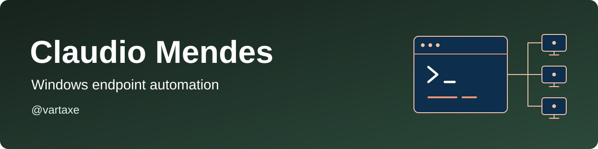

  

# Claudio Mendes

Windows endpoint automation with PowerShell, Configuration Manager OS deployment, and Active Directory.

I build focused tools for repeatable deployment work: clear inputs, useful logs, and explicit outcomes.

**Start here:** [Browse the project catalogue](https://vartaxe.github.io/) for each tool's purpose, requirements, and documentation.

## Featured projects

- [Add computers to Active Directory groups](https://github.com/vartaxe/ConfigMgr-OSD-AddComputerToADGroup) — ConfigMgr task-sequence utility for verified group membership.
- [Copy OS deployment logs to a file share](https://github.com/vartaxe/ConfigMgr-OSD-CopyOSDLogToFileShare) — collects and archives logs, with local retention if upload fails.
- [Disk partition layout](https://github.com/vartaxe/ConfigMgr-OSD-DiskPartitionLayout) — WinPE disk layout tool. **It irreversibly cleans and repartitions the selected disk.**
- [Driver Automation Tool](https://github.com/vartaxe/DriverAutomationTool) — fork maintenance for OEM driver and BIOS package automation; original authorship and licensing remain with the upstream project.

The catalogue links to each project's authoritative README, release, and validation guidance. Review compatibility and test in your own environment before deployment; automated checks are not a substitute for live testing.

[@vartaxe on GitHub](https://github.com/vartaxe) · [Contact](mailto:vartaxe@outlook.com) · [Sponsor](https://github.com/sponsors/vartaxe)
